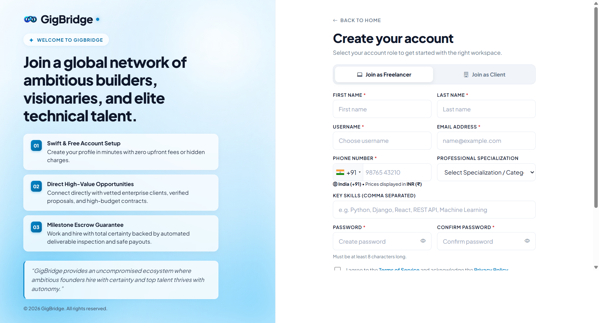
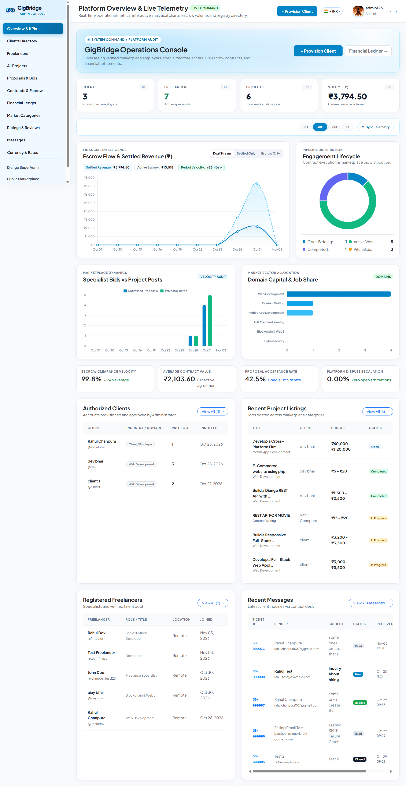
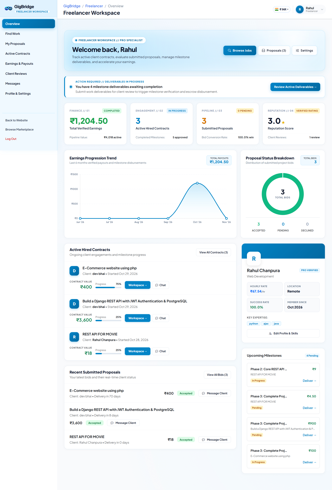

# GigBridge - Enterprise Freelance Marketplace & Escrow Platform

GigBridge is an enterprise-grade Django-based freelance marketplace and secure escrow platform that connects verified employers (clients) with top-tier technical and creative specialists (freelancers). The platform features structured sequential escrow milestone contracts, interactive deliverable inspections (live web URLs, Git repositories, and file handoffs), integrated Razorpay payment processing, real-time messaging, a dynamic dual-currency engine (INR `₹` & USD `$`), country-specific international phone validation, and an executive administration command center.

---

## Key Features

- **Role-Based Dedicated Workspaces**:
  - **Client Command Hub**: Post job opportunities with budget ranges, review incoming proposals, hire specialists, fund sequential escrow milestones, and release payments upon work verification.
  - **Freelancer Workspace**: Discover tailored opportunities via multi-token keyword search, submit competitive bids with cover letters, submit milestone deliverables, and track revenue ledgers with downloadable invoices.
  - **Executive Admin Command Center**: Real-time platform operational telemetry, escrow capital volume analytics, automated dispute mediation, and user moderation.
- **Sequential Escrow Milestone Pipeline**:
  - Multi-phase delivery cycles (e.g. 25% Advance Kickoff, 50% Core Development, and 25% Final Delivery & Handover) with tamper-resistant financial state machines.
  - Funds remain protected in escrow until the client reviews submitted deliverables and explicitly approves release.
- **Interactive Deliverables & Code Review**:
  - Freelancers submit deliverables including live demo URLs, GitHub/GitLab repository links, zipped file archives, and structured release notes.
  - Clients can review submissions, test live preview links, request revisions with detailed feedback, or approve releases.
- **Dual-Currency Architecture (INR `₹` & USD `$`)**:
  - Automatic detection based on the user's registered country (India = `INR`, all other countries = `USD`).
  - Stored financial ledger amounts remain in base INR, while display amounts dynamically convert to the active currency at the current exchange rate (default: `83.0 INR/USD`).
  - Active currency selector dropdown available across Client, Freelancer, and Admin portals.
  - Contract exchange rates are permanently locked at formation so subsequent rate fluctuations do not alter agreed milestone values.
- **Multi-Field Smart Search & Project Filtering**:
  - Tokenized full-text search across project titles, descriptions, required skill stacks, category names, and client identities.
  - Handles hyphenated technical terms (`full-stack`, `cross-platform`, `e-commerce`), comma-separated skills, and multi-word keywords with zero dead-ends.
  - Dynamic filters for project status (*Open for Bidding*, *In Progress*, *Completed*), budget type (*Fixed* vs. *Hourly*), and currency-aware budget ranges.
- **Country-Specific Phone Validation**:
  - Powered by Google `phonenumbers` and `intl-tel-input`.
  - Enforces national phone formatting for India (`+91`) and the United States (`+1`), automatically synchronizing default display currencies.
- **Direct Messaging & Project Conversations**:
  - Real-time communication channels between clients and freelancers linked directly to project postings and active contracts.
- **Ratings & Verified Testimonials**:
  - Verified post-completion review system with multi-criteria ratings (Quality, Communication, Deadlines, Professionalism) displayed on talent profiles.

---

## Technology Stack

- **Backend**: Python 3.12, Django 5.x
- **Database**: SQLite (Development) / PostgreSQL (Production ready)
- **Payment Gateway**: Razorpay Python SDK
- **Frontend**: HTML5, CSS3, Bootstrap 5.3, Chart.js, Bootstrap Icons
- **Image & File Processing**: Pillow
- **International Validation**: Google `phonenumbers` & `intl-tel-input`
- **Exchange Rate Engine**: Dynamic currency context processors & template tags

---

## Setup & Installation

### 1. Clone the Repository

```bash
git clone https://github.com/brainybeamGit/GigBridge-Django-P1.git
cd GigBridge-Django-P1/GigBridge
```

### 2. Environment Configuration

Copy the provided `.env.example` template to `.env`:

```bash
# On Linux / macOS
cp .env.example .env

# On Windows (PowerShell / Command Prompt)
copy .env.example .env
```

Review `.env` and configure your settings (Razorpay keys, email credentials, exchange rates).

### 3. Installation on macOS / Linux

```bash
# Create and activate virtual environment
python3 -m venv venv
source venv/bin/activate

# Install dependencies
pip install -r requirements.txt

# Run database migrations
python manage.py migrate

# Seed initial categories & dummy accounts (1 Admin, 2 Clients, 3 Freelancers)
python manage.py seed_data

# Start development server
python manage.py runserver 127.0.0.1:8000
```

### 4. Installation on Windows

```powershell
# Create and activate virtual environment
python -m venv venv
.\venv\Scripts\activate

# Install dependencies
pip install -r requirements.txt

# Run database migrations
python manage.py migrate

# Seed initial categories & dummy accounts (1 Admin, 2 Clients, 3 Freelancers)
python manage.py seed_data

# Start development server
python manage.py runserver 127.0.0.1:8000
```

---

## Default Demo Accounts & Credentials

The seed command initializes **1 Admin**, **2 Clients**, and **3 Freelancers** with active projects, milestone pipelines, and reviews.

**Master Password for All Accounts**: `Password123!`

| Role | Username | Password | Email | Region / Currency | Profile Specialization | Portal Route |
|---|---|---|---|---|---|---|
| **Admin** | `admin123` | `Password123!` | `admin@gigbridge.com` | Global / INR | Platform Operations Superuser | [`/adminpanel/`](http://127.0.0.1:8000/adminpanel/) |
| **Client 1** | `client1` | `Password123!` | `david.miller@techcorp.io` | USA / USD (`$`) | David Miller (VP of Engineering, TechCorp Solutions) | [`/client/dashboard/`](http://127.0.0.1:8000/client/dashboard/) |
| **Client 2** | `client2` | `Password123!` | `priya.sharma@innovatelabs.in` | India / INR (`₹`) | Priya Sharma (Product Director, InnovateLabs Digital) | [`/client/dashboard/`](http://127.0.0.1:8000/client/dashboard/) |
| **Freelancer 1** | `freelancer1` | `Password123!` | `alex.rivera@devbridge.com` | India / INR (`₹`) | Alex Rivera (Lead Full-Stack & Python Architect) | [`/freelancer/dashboard/`](http://127.0.0.1:8000/freelancer/dashboard/) |
| **Freelancer 2** | `freelancer2` | `Password123!` | `sarah.chen@mobileworks.com` | USA / USD (`$`) | Sarah Chen (Senior Flutter & Mobile UI/UX Engineer) | [`/freelancer/dashboard/`](http://127.0.0.1:8000/freelancer/dashboard/) |
| **Freelancer 3** | `freelancer3` | `Password123!` | `marcus.vance@cloudscale.net` | India / INR (`₹`) | Marcus Vance (DevOps & Cloud Systems Architect) | [`/freelancer/dashboard/`](http://127.0.0.1:8000/freelancer/dashboard/) |

*(New clients and freelancers can also register at [`/accounts/register/`](http://127.0.0.1:8000/accounts/register/))*

---

## Environment Variables Reference

| Variable | Default Value | Description |
|---|---|---|
| `SECRET_KEY` | `django-insecure-...` | Django cryptographic secret key (change in production) |
| `DEBUG` | `True` | Django debug mode toggle |
| `ALLOWED_HOSTS` | `127.0.0.1,localhost` | Comma-separated allowed HTTP host header values |
| `RAZORPAY_KEY_ID` | `rzp_test_...` | Razorpay public key ID for escrow checkout |
| `RAZORPAY_KEY_SECRET` | `...` | Razorpay private secret key for signature verification |
| `USD_INR_RATE` | `83.0` | Default exchange rate conversion (USD to INR) |
| `PAYMENT_CURRENCY` | `INR` | Razorpay order charging currency |
| `EMAIL_BACKEND` | `smtp.EmailBackend` | Django email engine (`console` for dev, `smtp` for prod) |
| `EMAIL_HOST` | `smtp.gmail.com` | Outgoing SMTP email host |
| `EMAIL_PORT` | `587` | SMTP communication port |
| `EMAIL_HOST_USER` | `...` | SMTP username / sender email |
| `EMAIL_HOST_PASSWORD` | `...` | SMTP application password |

---

## Key Portal Routes & Navigation

| Portal | URL Path | Description |
|---|---|---|
| **Public Landing** | `/` | Showcase of featured projects, top talent, categories, and testimonials |
| **Project Board** | `/projects/` | Tokenized search, status filtering, category chips, and project cards |
| **Project Detail** | `/projects/<id>/` | Project brief, budget range, client details, and proposal submission form |
| **Categories** | `/categories/` | Explore marketplace categories and talent count |
| **Client Dashboard** | `/client/dashboard/` | Real-time telemetry, active contracts, recent proposals, and action center |
| **Client Projects** | `/client/projects/` | Create, edit, close, and monitor postings |
| **Client Contracts** | `/client/contracts/<id>/` | Executive overview, sequential milestone stepper, Razorpay escrow funding |
| **Client Payments** | `/client/payments/` | Escrow breakdown, transaction history, and downloadable invoices |
| **Freelancer Dashboard** | `/freelancer/dashboard/` | Earnings metrics, proposal pipeline, active contracts, and recommendations |
| **Freelancer Earnings** | `/freelancer/earnings/` | Payout history, pending milestone payouts, and monthly revenue chart |
| **Admin Panel** | `/adminpanel/` | Operational telemetry, user registries, dispute resolutions, currency toggle |
| **Django Admin** | `/admin/` | Standard Django low-level ORM administration |

---

## Screenshots

### 1. Public Marketplace Home


### 2. User Authentication


### 3. Role-Based Registration


### 4. Admin Command Center & Telemetry


### 5. Freelancer Workspace & Dashboard

