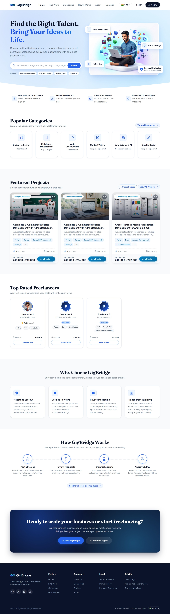
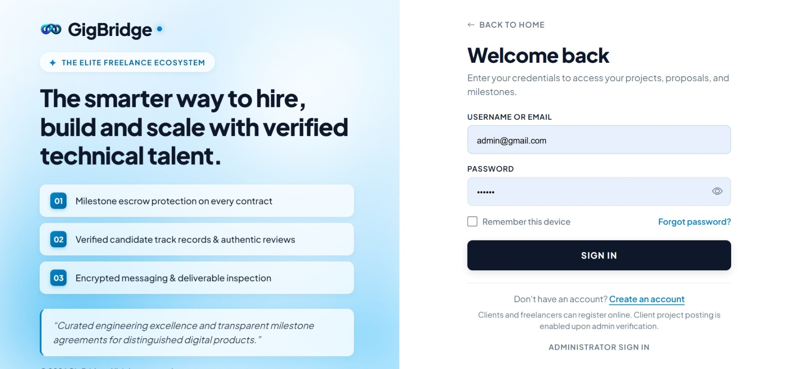
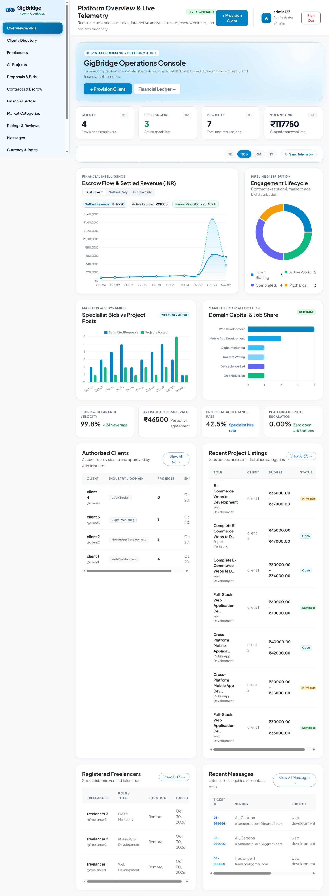
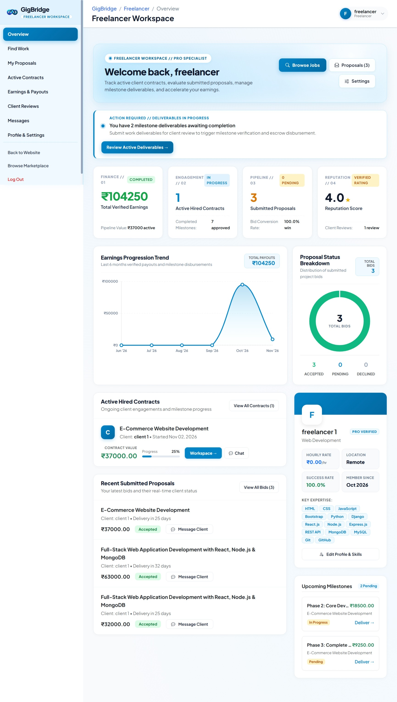

# GigBridge

GigBridge is an enterprise-grade Django-based freelance marketplace and secure escrow platform that connects employers (clients) with verified talent (freelancers). The platform features structured sequential escrow milestone contracts, interactive deliverable inspections (code repositories, live previews, and file handoffs), integrated payment processing, real-time messaging, dual-currency support (INR & USD), and a comprehensive executive administration command center.

---

## Project Features

- **Role-Based Workspaces**: Dedicated portals with tailored capabilities for **Clients**, **Freelancers**, and **Superuser Administrators**.
- **Sequential Escrow & Milestone Pipeline**: Structured multi-phase delivery cycles (e.g., 25% Advance Kickoff, 50% Core Development, and 25% Final Delivery & Handover) with secure escrow lock and release workflows.
- **Interactive Deliverables & Code Review**: Freelancers submit deliverables including live demo URLs, Git repository links, compressed file archives, and structured work notes. Clients can review submissions, request revisions, or approve releases.
- **Razorpay Escrow Payment Gateway**: Integrated milestone payment verification and release simulation with automated generation of official tax-compliant invoices.
- **Dual-Currency Support (INR & USD)**: Dynamic currency resolution based on user preferences and request headers with real-time conversion between Indian Rupees (`₹`) and US Dollars (`$`).
- **Country-Specific Phone Validation**: Phone number inputs supporting India (`+91`) and United States (`+1`) with international validation via `phonenumbers`.
- **Direct Messaging & Project Conversations**: Built-in communication channels between clients and freelancers linked directly to project postings and active contracts.
- **Client Job & Bid Management**: Clients can publish detailed project opportunities with budget ranges, evaluate bids, compare specialist profiles, and form escrow-backed contracts.
- **Freelancer Earnings & Invoicing**: Comprehensive earnings ledger, pending escrow commitments, completed contracts archive, and downloadable PDF-ready invoices.
- **Ratings & Verified Reviews**: Verified post-completion review system with star ratings and client testimonials displayed on talent profiles.
- **Executive Admin Command Center**: Centralized administration dashboard featuring real-time operational metrics, interactive analytical charts, escrow volume telemetry, and user moderation registries.

---

## Technology Stack

- **Backend**: Python 3.12, Django 5.x
- **Database**: SQLite (Development) / PostgreSQL compatible
- **Payments**: Razorpay SDK
- **Frontend**: HTML5, CSS3, Bootstrap 5, Chart.js, Bootstrap Icons
- **Image & File Processing**: Pillow
- **Validation**: Google `phonenumbers`

---

## Setup Commands

### Clone Repository

```bash
git clone https://github.com/brainybeamGit/GigBridge-Django-P1.git
cd GigBridge-Django-P1/GigBridge
```

### Installation on macOS / Linux

```bash
# Create and activate virtual environment
python3 -m venv venv
source venv/bin/activate

# Install dependencies
pip install -r requirements.txt

# Run database migrations
python manage.py migrate

# Start development server
python manage.py runserver
```

### Installation on Windows

```powershell
# Create and activate virtual environment
python -m venv venv
venv\Scripts\activate

# Install dependencies
pip install -r requirements.txt

# Run database migrations
python manage.py migrate

# Start development server
python manage.py runserver
```

---

## Local Server

- **Platform URL**: [http://127.0.0.1:8000/](http://127.0.0.1:8000/)

---

## Default Credentials

### Administrator / Superuser

- **Username**: `admin123`
- **Email**: `admin123@gmail.com`
- **Password**: `admin123`

### Platform Role Accounts

| Role | Username | Email | Portal Access |
|---|---|---|---|
| **Admin** | `admin123` | `admin123@gmail.com` | [http://127.0.0.1:8000/adminpanel/](http://127.0.0.1:8000/adminpanel/) |
| **Client** | `client1` | `client1@gmail.com` | [http://127.0.0.1:8000/client/dashboard/](http://127.0.0.1:8000/client/dashboard/) |
| **Freelancer** | `freelancer1` | `freelance1@gmail.com` | [http://127.0.0.1:8000/freelancer/dashboard/](http://127.0.0.1:8000/freelancer/dashboard/) |

*(New clients and freelancers can also register at [http://127.0.0.1:8000/register/](http://127.0.0.1:8000/register/))*

---

## Key Portal Routes

| Portal | URL Route | Description |
|---|---|---|
| **Home Page** | `/` | Public marketplace landing page with featured projects and top talent |
| **Project Catalog** | `/projects/` | Search, filter, and browse open project postings |
| **Categories** | `/categories/` | Explore marketplace categories and industry specializations |
| **Client Dashboard** | `/client/dashboard/` | Post jobs, manage proposals, inspect deliverables, and release escrow |
| **Freelancer Workspace** | `/freelancer/dashboard/` | Submit proposals, deliver milestone work, track earnings and invoices |
| **Admin Command Center** | `/adminpanel/` | Real-time analytics, user registry moderation, and escrow volume |
| **Django Admin** | `/admin/` | Standard Django ORM model management |

---

## Screenshots

### 1. Home Page


### 2. Login Page


### 3. Admin Dashboard


### 4. Freelancer Workspace

